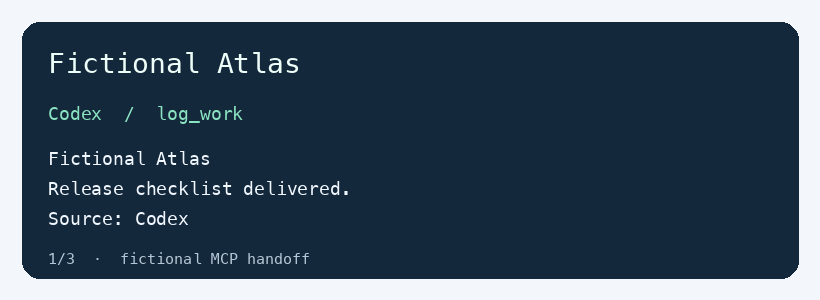
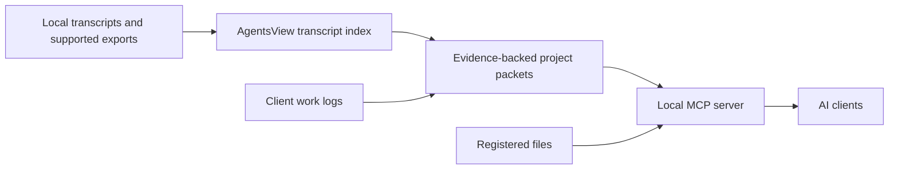
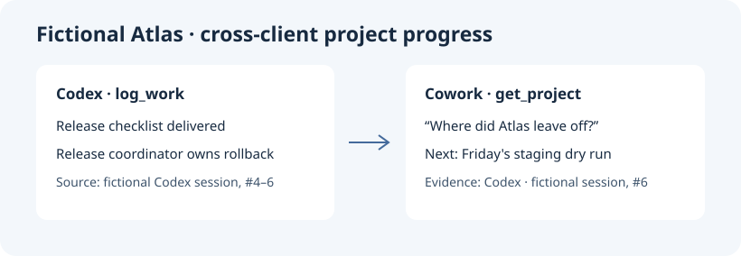

# agent-brain

Try the fictional handoff first. With Python 3.12 and Node.js 22 or newer, run `./install.sh --demo`. The installer backs up existing configuration and stages MCP entries for the detected clients. Import the generated Kimi Work plugin folder and the DeepSeek Harness connector JSON in their respective clients.

Run regressions with `python3 -B -m unittest discover -s tests` and `python3 -B evaluation.py --fictional`. The verified AgentsView baseline is v0.47.0 at commit `1079cb632051e8c9cbad2dcc945a60643c756d81`. Before upgrading, use a separate data directory to ingest the same fictional sessions. Compare message identities, tool outputs, and evaluation results before switching your daily installation.

[简体中文](README.zh-CN.md)

Agent Brain gives local AI clients the same project progress cards and work log. AgentsView indexes recorded sessions. An optional background model extracts project assignments, task deliverables and user requirements from visible dialogue. Client models read short cards with source references when they resume a project. Agents record completed work through `log_work`.

## Quick start

Use Python 3.12+, Node.js 22+, Zstandard and the [AgentsView v0.47.0 CLI](https://github.com/kenn-io/agentsview/releases/tag/v0.47.0). Set `AGENT_BRAIN_DATA` to a directory outside the repository if you prefer a location other than `~/SharedBrain`.

1. Copy `examples/config.example.json` to the data directory as `config.json`. Set the model URL and ID if you plan to summarize historical sessions with `backfill`. Keep model credentials in an environment variable if your endpoint needs them.
2. Set `AGENTSVIEW_BIN` if the binary is outside your PATH. Stop the AgentsView daemon for this archive, then run `node collect.mjs` to prepare redacted input and update the index. To refresh selected inputs, pass source names, for example `node collect.mjs kimi-work cowork`. Agent Brain starts an authenticated loopback query service when needed.
3. Run `python3 brain.py backfill` to summarize historical sessions and generate `_index.md`, `card.md` and `log.md` in the data directory. Add `--agent kimi-work --sort messages:asc --limit 8` to try a small batch of short sessions. Repeated runs skip completed unchanged sessions.
4. Connect each client to the stdio command `python3 /absolute/path/to/agent-brain/brain.py mcp`, with the same `AGENT_BRAIN_DATA`. Add [the skill](skills/agent-brain/SKILL.md) or copy its instructions into the client.

## Architecture

Clients read compact project packets and request specific source sections when needed. The optional `extract-packets` job uses the configured Magpie Eco route for selected chat messages and file references. Document bodies use local extraction. Only enable this route for chat data you have approved for that provider.

## Clients

- Codex: register the command as a local MCP server and install the skill in an available skills directory.
- Claude Cowork: use a local Cowork plugin or local workspace instructions where the mode can access the command.
- DeepSeek Harness: import the command as a local stdio connector and add the skill instructions to the working agent.
- Kimi Work: register a personal plugin with the local stdio server and the skill.
- Antigravity: the installer stages its local MCP entry. Archive coverage depends on the client and source mode.

Use `get_project` for a named project, `find_project` for an unclear name, and `list_projects` for a cross-project overview. `get_project` builds a short card locally from existing records. Use `section` and `next_offset` for more detail, and `search` or `get_session` for specific evidence. Response pages use a UTF-8 byte limit to keep tool text within the 2,000-token budget for byte-based tokenizers. Model turn usage is measured separately. All clients share the same archive. History coverage depends on the local source, especially for cloud Cowork tasks. [AgentsView source documentation](https://www.agentsview.io/docs/configuration/#session-discovery)

To keep the local index up to date, run `AGENT_BRAIN_SYNC_DAEMON=1 node collect.mjs` periodically with your operating system's scheduler. Set `AGENTSVIEW_BIN` and `ZSTD_BIN` to their absolute paths. The collector updates changed redacted copies through the authenticated local AgentsView service and allows one collection run at a time. Collection updates transcript search. Run `backfill` or use `log_work` to update project summaries.

Project packets retain source materials, one current deliverable per task, and evidence-backed user requirements. `get_project` supports `inputs`, `deliverables`, `rules`, `todos`, `history`, and `timeline`. `log_work` accepts `inputs`, `deliverables` with a stable `task` name, and scoped `rules`. Use `confirmed` only for a version the user explicitly selected. `build-packets --files` prebuilds active packets and caches short extracts by file fingerprint. Other projects build on first access. Set `AGENT_BRAIN_PACKET_PYTHON` to refresh packets after collection. The local Homebrew macOS scheduler path does this by default.

Use `read_file` with a registered absolute path or the project and a unique filename shown on its card. Select a Word or Markdown heading, a PDF page or keyword, or an Excel sheet. Resume with `next_offset` on longer sections. PDF extraction uses `pdftotext`. Returned text is evidence for the current client. Use `merge-candidates` to review possible duplicates, `merge-projects` to retain old names and IDs as aliases, and `move-record` to correct a specific derived work record.

## Local operations

- Check the archive version and create a local SQLite backup with `python3 brain.py health --verify-archive --backup`.
- Import a local Claude export with `python3 brain.py import-conversations claude-ai /path/to/export.zip`. Reimporting the same export leaves a single copy of each conversation.
- Index an explicitly chosen Obsidian vault with `python3 brain.py index-obsidian /path/to/vault`.
- Generate the last complete week's private reports with `python3 brain.py weekly-report`. Set `AGENT_BRAIN_WEEKLY=1` in your periodic collector to generate them on Monday in Asia/Shanghai.

## Fictional demo

Run `python3 scripts/demo.py`. A fictional Codex work log appears in the same project card when a second MCP client asks for progress. The command runs locally with temporary data.

The same handoff was tested in Claude Cowork by opening the generated Markdown card in a test folder and asking, “For Fictional Atlas, give its current progress, rollback owner, next step, and Codex source.” Cowork returned the prepared checklist, the release coordinator, the Friday dry run and the `codex:fictional-atlas-demo` reference. Cowork also ran the local Python CLI against the fictional data and recorded a `log_work` entry. The test used sibling `code/` and `data/` directories in the mounted folder.

## FAQ

**What does Agent Brain add to a conversation archive?** AgentsView indexes old messages. Agent Brain organizes evidence from those messages and new work logs by project, task deliverable and scoped requirement. A note-based workflow can also record work directly with `log_work`.

**When does a model run?** The MCP reads existing packets and registered files locally. A separately initiated backfill or packet extraction run uses its configured model. This lets the client model spend its context on the brief and fetch one relevant file section if needed.

**Why can a chat be searchable before it appears in the card?** Indexing and project extraction advance separately. A client can record the deliverable immediately with `log_work`. Use `health` to inspect collection and refresh status.

**How can I read a long or missing deliverable?** Expand the project’s `deliverables` section and use `read_file` for a registered file. For a historical file that moved, `register-path` can link a verified copy of the same filename.

## Data

Agent transcripts are read in place. The collector prepares separate copies with recognizable credentials replaced by placeholders, then points AgentsView at those copies. Redaction is best effort. Source files, configuration with real endpoints, archives and project cards belong outside this repository. A configured model processes the text it receives. Use a local model to keep backfill on the machine. Legacy chat instructions are reference material.

Backfill leaves Codex approval subagents in the archive and skips generating project summaries for their machine-generated reviews. If the configured endpoint supports OpenAI-style `json_schema`, set `model.structured_output` to `true` to constrain summary output. A backfill exits with an error status if any session failed and preserves completed chunks for a rerun.

Set `AGENT_BRAIN_MODEL_CONFIG` to a private JSON file with the model settings to select a route for one run. `chunk_chars` controls the approximate characters per request, and `match_catalog_names` limits project context to names mentioned in the dialogue. `extra_body.stream` enables streaming. A quota or gateway error ends the run at the current session so you can retry or select another route.
