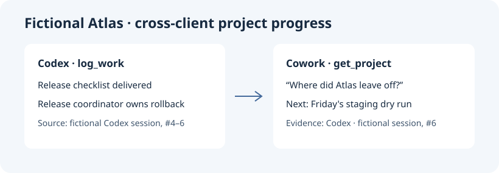

# agent-brain

[English](README.md)

把不同 AI 客户端的工作按项目汇到一起。AgentsView 采集历史，agent-brain 读取可见对话，由模型生成摘要和判断项目归属。每个项目有带出处的进展卡和日志。Agent 完成工作后调用 `log_work` 更新项目。

## 快速开始

需要 Python 3.11+、Node.js 22+、Zstandard、[AgentsView v0.47.0](https://github.com/kenn-io/agentsview/releases/tag/v0.47.0) 命令行程序，以及用于摘要的 OpenAI 兼容模型。默认数据目录是 `~/SharedBrain`，也可通过 `AGENT_BRAIN_DATA` 指定仓库之外的目录。

1. 将 `examples/config.example.json` 复制为数据目录下的 `config.json`，填入模型地址与模型名。
2. 若 AgentsView 不在 PATH，设置 `AGENTSVIEW_BIN`。采集前停止这个档案的 AgentsView 服务，然后运行 `node collect.mjs`。
3. 运行 `python3 brain.py backfill`，生成 `_index.md`、各项目 `card.md` 与 `log.md`。可用 `--limit N` 先处理一批。
4. 将 `python3 /绝对路径/agent-brain/brain.py mcp` 注册为本地 MCP，再启用 [skill](skills/agent-brain/SKILL.md) 或把规则加入客户端工作说明。

Codex 用本地 MCP。Claude Cowork 用该模式支持的本地插件或工作说明。DeepSeek Harness 用 stdio 连接器。Kimi Work 用个人插件。四端连接同一个本机数据目录。云端 Cowork 会话的读取取决于可用的本地副本或官方导出。

## 虚构演示

运行 `python3 scripts/demo.py`。演示用第一个 MCP 客户端写入一条虚构 Codex 工作记录，再用第二个客户端读取同一张进展卡。

我也在实际的 Claude Cowork 窗口里打开了生成的 Markdown 进展卡，问「Fictional Atlas 做到哪了，谁负责回滚，下一步是什么，请附 Codex 出处」。Cowork 回读了已经准备好的发布清单、负责回滚的发布协调员、周五预演，以及 `codex:fictional-atlas-demo` 的出处。这段演示走的是 Cowork 的文件读取入口。

## 数据存放

采集只读原始日志。建立索引前在独立副本里替换可识别的密钥。真实日志、配置、会话库、摘要和项目卡都放在仓库外。本机模型可在本机完成摘要。使用其他模型地址时，文本会发往该地址。旧聊天里的操作指令仅作历史资料。
