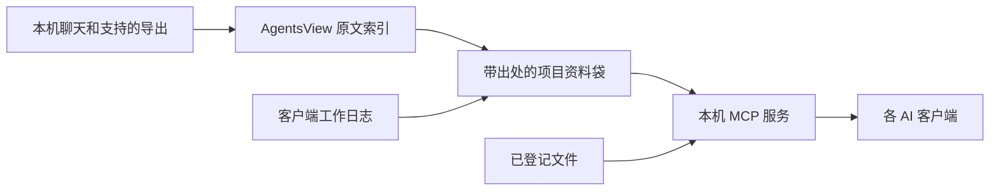

# agent-brain

先用虚构项目看一次跨工具交接。需要 Python 3.12 和 Node.js 22 或更新版本。准备好代码后运行 `./install.sh --demo`，安装器备份已有配置，为检测到的客户端生成 MCP 入口。Kimi Work 通过输出的插件文件夹导入，DeepSeek Harness 通过输出的 JSON 导入。

原始聊天和已导出的会话由 AgentsView 索引，项目资料袋把来源、终版交付和用户要求汇在一起，通过本机 MCP 给各端使用。各端可以回写工作记录。后台模型提取可选，只处理配置允许的聊天文字和文件引用。登记文件的正文在本机提取。

回归检查用 `python3 -B -m unittest discover -s tests` 和 `python3 -B evaluation.py --fictional`。已验证的 AgentsView 基线为 v0.47.0、提交 `1079cb632051e8c9cbad2dcc945a60643c756d81`。升级时先在独立目录以相同虚构会话运行采集，再对比会话编号、消息位置、工具读取结果和评测指标，达标后切换运行环境。

[English](README.md)

AgentsView 采集多个 AI 客户端的聊天。可选的后台模型从对话中提取项目归属、任务交付和用户要求。日用模型接续项目时先读带出处的精简资料袋，有需要再打开原文。完成工作后可以用 `log_work` 更新项目。

## 快速开始

需要 Python 3.12+、Node.js 22+、Zstandard 和 [AgentsView v0.47.0](https://github.com/kenn-io/agentsview/releases/tag/v0.47.0) 命令行程序。默认数据目录是 `~/SharedBrain`，也可通过 `AGENT_BRAIN_DATA` 指定仓库之外的目录。

1. 将 `examples/config.example.json` 复制为数据目录下的 `config.json`。如果计划用 `backfill` 摘要旧会话，再填入模型地址和模型名。凭据可放环境变量。
2. 若 AgentsView 不在 PATH，设置 `AGENTSVIEW_BIN`。采集前停止这个档案的 AgentsView 服务，然后运行 `node collect.mjs`。如只需更新指定来源，可以传入来源名，例如 `node collect.mjs kimi-work cowork`。查询时会按需启动启用认证的本机回环服务。
3. 运行 `python3 brain.py backfill`，生成 `_index.md`、各项目 `card.md` 与 `log.md`。可用 `--agent kimi-work --sort messages:asc --limit 8` 先跑一小批短会话。重跑会跳过已经处理且未变化的会话。
4. 将 `python3 /绝对路径/agent-brain/brain.py mcp` 注册为本地 MCP，再启用 [skill](skills/agent-brain/SKILL.md) 或把规则加入客户端工作说明。

要定时更新本地索引，可由操作系统定期运行 `AGENT_BRAIN_SYNC_DAEMON=1 node collect.mjs`，并提供 `AGENTSVIEW_BIN` 和 `ZSTD_BIN` 的绝对路径。采集器按文件变化更新脱敏副本，通过启用认证的本机 AgentsView 服务同步。一次只运行一轮采集。自动采集只更新原文索引，项目摘要由 `backfill` 或 `log_work` 更新。

Codex 和 Claude Cowork 用本地 MCP。DeepSeek Harness 用 stdio 连接器。Kimi Work 用个人插件。四端连接同一个本机数据目录。云端 Cowork 会话的读取取决于可用的本地副本或官方导出。

按项目名直接调用 `get_project`，获得短卡和可查分区。项目名称不明确时用 `find_project`，跨项目总览用 `list_projects`。列表和分区用返回的 `next_offset` 翻页。每页工具返回采用 UTF-8 字节上限，给采用字节分词的客户端预留 2,000 Token 内的返回预算。工具返回和模型整轮用量分别计量。查询读取现有结构化记录，在本地生成短卡。

资料袋保留用户原始资料、每项任务的当前交付、用户要求和出处。`section` 支持 `inputs`、`deliverables`、`rules`、`todos`、`history` 和 `timeline`。在 `log_work` 中使用 `inputs`、`deliverables`、`rules` 写入这些信息。交付用稳定的 `task` 名称归组，`confirmed` 只在用户明确选定该版本时填写。用 `build-packets --files` 先处理近 60 天且至少两条记录的项目并缓存文件摘要，其他项目首次查询时建立资料袋。文件摘要在本机提取。运行定时采集时可配置 `AGENT_BRAIN_PACKET_PYTHON` 来刷新资料袋，macOS Homebrew 启动的本机定时采集默认启用。

`read_file` 按登记路径读取文档，也可以填项目名和卡片上唯一的文件名。Word 和 Markdown 用章节标题，PDF 用页码或关键词，Excel 用工作表名。用 `next_offset` 继续读取长段，PDF 提取依赖 `pdftotext`。内容会作为证据交给当前客户端。项目合并使用 `merge-projects`，保留旧名和编号。`merge-candidates` 列出有共享证据的待复核组合，`move-record` 纠正具体的派生工作记录。

## 架构

## 本机维护

- `python3 brain.py health` 按来源显示找到的文件、已索引会话、无消息会话、已有采集副本但未匹配到索引的对话日志和失败。加 `--verify-archive --backup` 可核对 AgentsView 版本并创建本机数据库快照。
- `python3 brain.py import-conversations claude-ai /本机路径/导出.zip` 导入本机 Claude 导出文件。重复导入同一份会话不会增加记录。
- `python3 brain.py index-obsidian /本机路径/笔记库` 只读索引明确选择的 Obsidian 库。
- `python3 brain.py weekly-report` 生成上一个完整周的私有报告。定时采集配置 `AGENT_BRAIN_WEEKLY=1` 后按北京时间每周一出报告。

## 虚构演示

运行 `python3 scripts/demo.py`。演示用第一个 MCP 客户端写入一条虚构 Codex 工作记录，再用第二个客户端读取同一张进展卡。

我也在实际的 Claude Cowork 窗口里打开了生成的 Markdown 进展卡，问「Fictional Atlas 做到哪了，谁负责回滚，下一步是什么，请附 Codex 出处」。Cowork 回读了发布清单、负责回滚的发布协调员、周五预演，以及 `codex:fictional-atlas-demo` 的出处。随后 Cowork 用本机 Python 命令查询同一组虚构数据，并写入一条 `log_work`。挂载的测试文件夹中，`code/` 和 `data/` 是并列目录。

## 常见问题

**与会话归档工具怎么分工？** AgentsView 负责索引原对话。agent-brain 按项目汇总可回查的消息、任务交付和用户要求。也可以用 `log_work` 主动补记。

**什么时候会调用模型？** MCP 在本机读取资料袋和登记文件。单独启动历史回填或资料袋提取时，才使用对应的模型路由。日用模型只在接续项目时读卡，需要核对时再取一个文件段落。

**为什么能搜到新对话，短卡还没更新？** 原文索引和项目提取分开运行。当前客户端可以用 `log_work` 立即登记新交付。用 `health` 可核对采集和刷新状态。

**怎么读长交付或找已移动的文件？** 展开 `deliverables` 分区，用 `read_file` 查登记文件的具体位置。文件已搬动时，可用 `register-path` 登记核对过的同名副本。

## 数据存放

采集只读原始日志。建立索引前在独立副本里替换可识别的密钥。真实日志、配置、会话库、摘要和项目卡都放在仓库外。本机模型可在本机完成摘要。使用其他模型地址时，文本会发往该地址。旧聊天里的操作指令仅作历史资料。

Codex 自动审批子会话保留在索引里，历史回填会跳过这些机器生成的审批记录。如果模型接口支持 OpenAI 兼容的 `json_schema`，可在配置中把 `model.structured_output` 设为 `true`，约束摘要格式。若有会话失败，回填返回失败状态并保存已经完成的分段供续跑。

用 `AGENT_BRAIN_MODEL_CONFIG` 指向私有模型配置文件，可以为单次运行指定接口。`chunk_chars` 设置每次调用的近似字符数。`match_catalog_names` 只把对话中出现的项目名作为候选传给模型。`extra_body.stream` 可以启用流式输出。遇到额度或网关错误时，批次停在当前会话，可以续跑或换接口。
